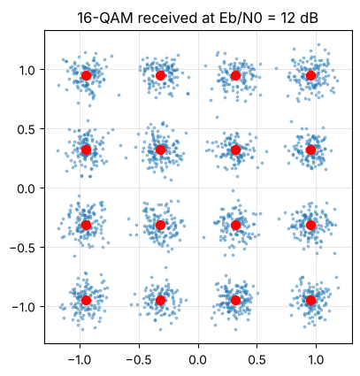
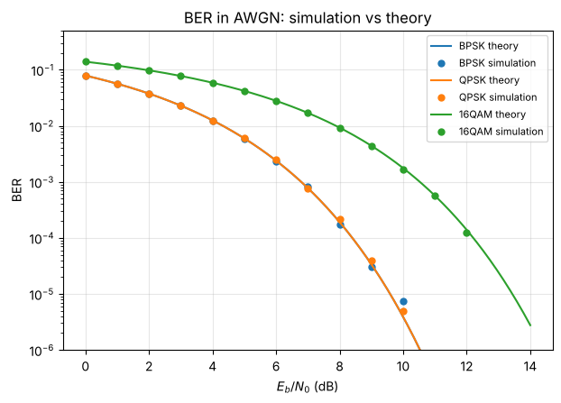

# Digital communications in Python: Lab 1 (free)

**From bits to symbols: BPSK, QPSK and 16-QAM**, a hands-on Jupyter notebook in plain NumPy:

- map bits to complex symbols, with Gray labelling
- normalise a constellation to unit average energy
- decide symbols back to bits with a minimum-distance detector
- a first look at noise, plus 3 exercises **with full solutions**



## Run it
```
pip install numpy scipy matplotlib jupyter
jupyter notebook lab01_bits_to_symbols.ipynb
```
Or open it in Google Colab or VS Code. Keep `dcomm.py` in the same folder.

## The full course: From Bits to OFDM
Lab 1 is the first of 8. The others take you all the way to a working receiver:

2. Noise and bit error rate: simulation vs theory
3. Pulse shaping, bandwidth and eye diagrams
4. The matched filter
5. Synchronisation: phase, frequency and timing
6. OFDM: IFFT/FFT, cyclic prefix, one-tap equaliser
7. Channel coding: Hamming (7,4), soft decisions, interleaving
8. Mini-project: a complete QPSK link, text to text



Every lab comes with exercises, full solutions and a PDF version.
**Get all 8 labs: https://tahamaroc.gumroad.com/l/bits-to-ofdm**

## Licence
This free lab is MIT-licensed: use it, share it, adapt it.
